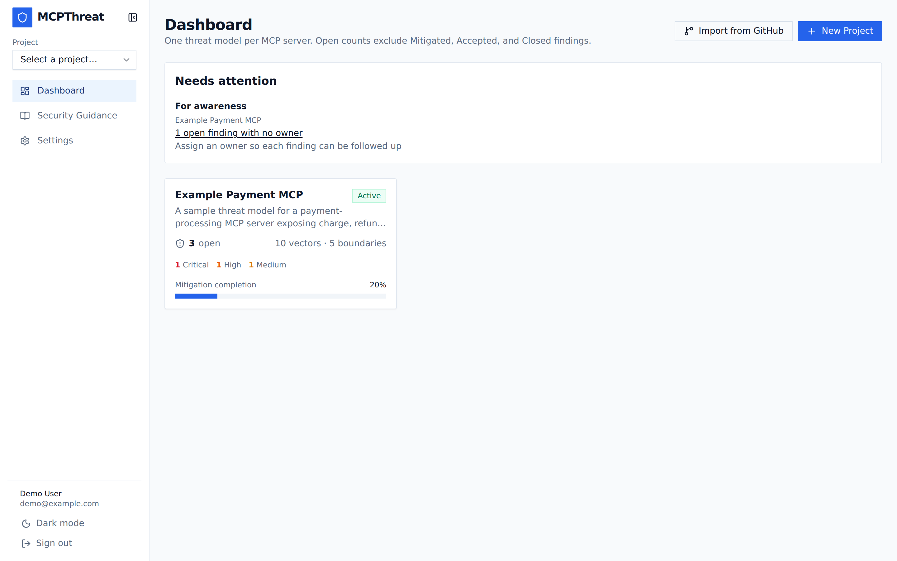
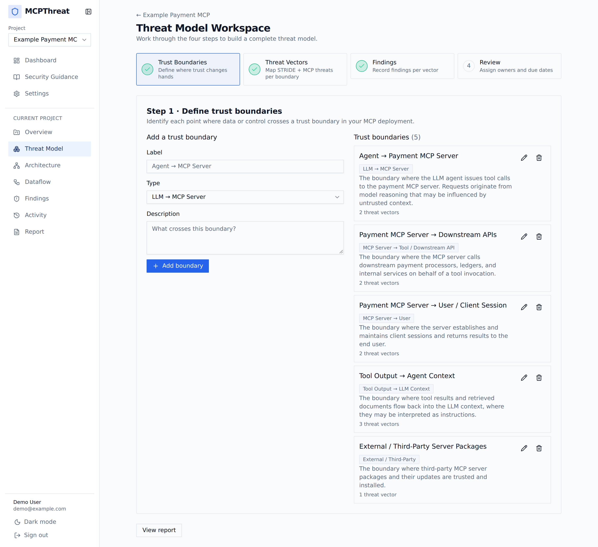
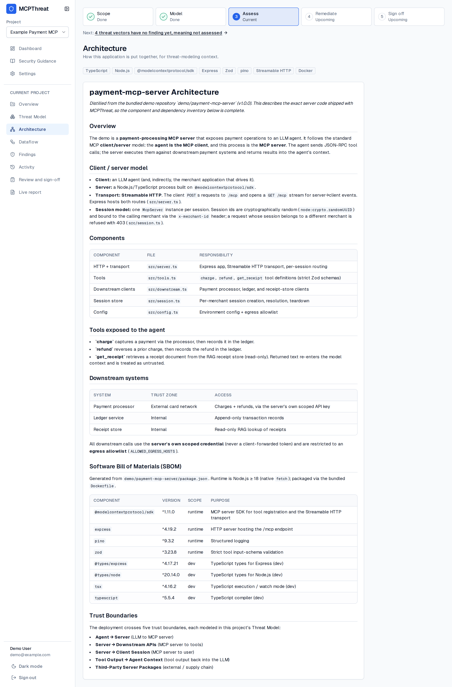
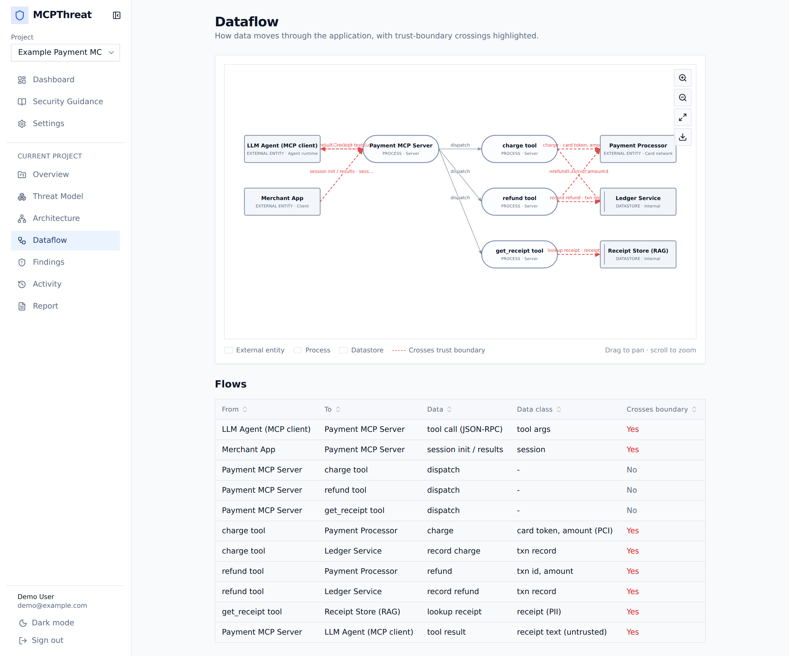
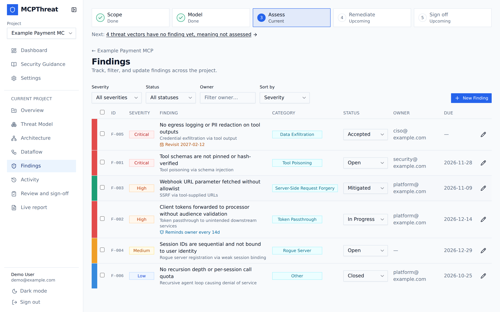

# MCPThreat

MCPThreat is a threat-modeling workspace for servers built on the Model Context Protocol (MCP).

It was built to answer one question for a given MCP server: **where can trust break down between the agent, the server, and the systems behind it, what has been decided about each threat, and who is responsible for it?**

MCP connects language-model agents to real tools, data, and downstream systems. That adds risks that general threat-modeling guidance covers poorly, such as prompt injection through tool output, tool poisoning, token passthrough, and context bleed between tenants. MCPThreat gives you a structured, repeatable way to record those risks and a report you can hand to someone else.

It supports a workflow, not a verdict. It does not scan or test your server. See [Limitations](#limitations).

## What you do with it

1. **Model.** Define trust boundaries, then record the threats that cross each one. Threats are classified by STRIDE category and by an MCP-specific category.
2. **Assess.** Score each threat by likelihood and impact, and raise findings with a severity, a rationale, and a recommendation.
3. **Track.** Assign owners and due dates, attach evidence, and move each finding to Mitigated, Accepted, or Closed. Acceptance can require one or two approvals.
4. **Report.** Export the assessment as HTML, Markdown, JSON, or a findings CSV, or print it to PDF.

Optionally, point MCPThreat at a GitHub repository and it will draft the architecture, a dataflow diagram, and a set of threats for you to review. Every drafted item is labelled AI-suggested with a confidence level.

## Quick start

You need Node.js 18.17 or later.

```bash
npm install
cp .env.example .env          # then set NEXTAUTH_SECRET, for example: openssl rand -base64 32
npx prisma migrate dev        # creates the local SQLite database
npm run seed                  # loads a worked example: "Example Payment MCP"
npm run dev                   # http://localhost:3000
```

Sign in with `demo@example.com` and `password123`. The seed also creates `client@example.com` with the same password, to try the two-party approval workflow. These logins are for local development only.

Then:

1. Open **Example Payment MCP** from the dashboard.
2. Look at **Threat Model**, **Findings**, and **Dataflow** to see how the pieces fit.
3. Open **Report** and download the HTML version.

To start your own, choose **New Project** on the dashboard. The empty state lists the four steps above.

## Sample report

A complete report generated from the seeded example is in [docs/sample-report.md](docs/sample-report.md), with the findings register as [docs/sample-findings.csv](docs/sample-findings.csv). Each report opens with an assessment record and a scope and limitations section. An excerpt:

```text
## 1. Assessment record
| Project                | Example Payment MCP               |
| Tool and version       | MCPThreat 1.0.0                   |
| Report generated       | 2026-11-14 03:22 UTC              |
| Risk-acceptance policy | Dual sign-off (assessor + client) |
| AI-suggested items     | 0 boundaries, 0 threat vectors, 0 findings |

## 7. Findings register
| ID    | Severity | Status      | Finding                                     | Threat vector | Owner                | Due        |
| F-001 | Critical | Open        | Tool schemas are not pinned or hash-verified| T-07          | security@example.com | 2026-11-28 |
| F-005 | Critical | Accepted    | No egress logging or PII redaction ...      | T-09          | ciso@example.com     | —          |
| F-002 | High     | In Progress | Client tokens forwarded to processor ...    | T-03          | platform@example.com | 2026-12-14 |

### F-001: Tool schemas are not pinned or hash-verified
Severity: Critical. Status: Open. Threat vector: T-07 (Tool Poisoning).
Framework mapping (indicative): LLM01, LLM04, LLM05, AML.T0051, AML.T0053
Description and rationale, Recommendation, and Evidence follow.
```

### What is in a report

- **Assessment record:** project, model source, tool version, generation time (UTC), people involved, acceptance policy, and how many items were AI-suggested.
- **Scope and limitations:** what the report does and does not claim.
- **Summary:** counts by severity, status, and risk band, with definitions of the terms used.
- **Findings:** a register, then one section per finding with severity, status, owner, rationale, recommendation, evidence, and any acceptance decision.
- **Framework mapping:** each MCP category cross-referenced to the OWASP Top 10 for LLM Applications (2025) and MITRE ATLAS. This is a mapping to help locate related guidance. It is not a certification or a compliance assessment.
- **Identifiers:** `B-nn` for trust boundaries, `T-nn` for threat vectors, and `F-nnn` for findings, shown on screen and in every export.

### Export formats

| Format | Use | How |
| --- | --- | --- |
| HTML | Reading, sharing, printing to PDF. One self-contained file, no scripts. | Report page, or `?format=html` |
| Markdown | Pasting into a ticket, wiki, or repository. | Report page, or `?format=md` |
| JSON | Machine use. Includes internal IDs and the audit trail. Carries a `schemaVersion`. | Report page, or `?format=json` |
| CSV | The findings register for a spreadsheet or workpaper. | Report page, or `?format=csv` |

The same data is available from `GET /api/projects/:id/report?format=<html|md|json|csv>` for a signed-in user with access to the project. Add `&download=1` to receive a file attachment.

## Limitations

Please read these before relying on a report.

- **It is a record of a threat model, not a test.** MCPThreat does not connect to, scan, or probe your MCP server. A finding exists because a person recorded it, or because an AI draft was accepted by a person. The absence of a finding does not mean the absence of a weakness.
- **Coverage depends on what was modeled.** Threats outside the categories used here are recorded as Other, or not at all.
- **AI-suggested items can be wrong or incomplete.** They are drafted by a language model from a limited selection of repository files (at most 24 files, each truncated at 24 KB). They are labelled and should be reviewed before use. The model used is not stored with the analysis.
- **Ratings are judgements.** Severity, likelihood, and impact are entered by people. The risk band is a fixed calculation from likelihood and impact.
- **Framework mappings are indicative.** They are not an attestation against OWASP, MITRE ATLAS, or any other framework.
- **Identifiers follow creation order.** They are stable while items are added or edited. Deleting an item renumbers later items of the same kind. Cite the export date and tool version with an identifier, or use the `uid` in the JSON export.
- **Evidence is not verified.** Text and attachments are recorded as supplied.
- **Version 1.0.** The data model and export schema may change in later versions.

## Features

**Threat modeling**
- Trust boundaries and threat vectors, classified by STRIDE and by an MCP-specific taxonomy ([src/lib/taxonomy.ts](src/lib/taxonomy.ts)).
- An interactive trust-boundary map and a likelihood by impact risk matrix, with a simple residual-risk adjustment.
- Architecture and Dataflow as first-class sections, with an exportable data-flow diagram.

**Findings and governance**
- A findings register with severity, status, owner, due date, evidence, and file attachments.
- A risk-acceptance workflow with three policies: off, single approver, or dual sign-off (assessor and client). Dual sign-off applies to High and Critical findings. Approvals expire and the finding reopens for review.
- An append-only audit trail of changes, and recurring email reminders to owners.

**GitHub import (optional)**
- Fetches from `github.com` only, selects relevant files, and uses Claude to draft architecture, dataflow, and threats. Only items with supporting evidence are created, each tagged AI-suggested with a confidence level.

**Access**
- Owner, admin, member, and viewer roles. Every access path goes through one authorization check.
- A Security Guidance section maps each MCP threat category to mitigations and cited references.

## Screenshots

**Dashboard**: projects with open-finding counts, severity breakdown, and mitigation progress.



**Threat model**: trust boundaries, the boundary map, and the risk matrix.



**Architecture**: a client and server breakdown with a software bill of materials, here generated from the bundled demo server.



**Dataflow**: an interactive data-flow diagram with trust boundaries marked.



**Findings**: a filterable, sortable register with IDs, severity, status, owners, and the acceptance workflow.



**Report**: the assessment record, scope and limitations, findings, and downloads.


## Configuration

Settings live in `.env` (see `.env.example`).

| Variable | Required | Purpose |
| --- | --- | --- |
| `DATABASE_URL` | Yes | SQLite file for development, or a Postgres URL. |
| `NEXTAUTH_SECRET` | Yes | Signs session tokens. Use a long random value. |
| `NEXTAUTH_URL` | Yes | The URL the app is served from. |
| `ANTHROPIC_API_KEY` | For GitHub import | Without it, import is shown as unavailable and manual modeling is unaffected. |
| `ANALYSIS_MODEL` | No | Overrides the model used for import. |
| `GITHUB_TOKEN` | No | Higher rate limits, or private repositories. A token entered in the UI is used for that request only and is not stored. |
| `GITHUB_ID`, `GITHUB_SECRET` | No | Enables "Continue with GitHub" sign-in. Callback: `/api/auth/callback/github`. |
| `SMTP_*`, `EMAIL_FROM` | No | Sends reminder email. Without SMTP, emails are written to the server log. |
| `CRON_SECRET` | No | Authenticates calls to `/api/cron/reminders` from an external scheduler. |

For production, set the `datasource` provider in `prisma/schema.prisma` to `postgresql` and point `DATABASE_URL` at your database. Enum-like fields are stored as strings and validated in the application, so the schema does not need to change. `GET /api/health` returns `{ status, db }` for deployment checks.

### Bundled demo MCP server

[`demo/payment-mcp-server`](demo/payment-mcp-server) is a small payment MCP server (Streamable HTTP; `charge`, `refund`, and `get_receipt` tools). The seeded example's architecture and dataflow are derived from it, and its software bill of materials is generated from its `package.json`.

## Commands

| Script | Purpose |
| --- | --- |
| `npm run dev` | Start the development server |
| `npm run build` | Production build, including typecheck and lint |
| `npm run lint` | ESLint |
| `npm test` | Unit tests for scoring, acceptance, URL guards, dataflow parsing, metrics, and the report formats |
| `npm run seed` | Load the demo project |
| `npm run db:reset` | Destructive: reset the development database and re-seed |

On Windows, stop the dev server before running `prisma migrate` or `prisma generate`, because the running server locks the Prisma engine.

To regenerate the screenshots, start the dev server with the demo seeded and run `node docs/capture-screenshots.mjs`.

## Security notes

User-supplied server URLs are validated (HTTPS only, private and reserved ranges blocked) and are never fetched automatically. GitHub import is locked to `github.com`. Responses carry a Content Security Policy and related headers. Sessions are signed JWTs. The HTML export is served with a restrictive policy of its own and escapes every value it prints.

## Built with

Next.js 14 (App Router), TypeScript, Prisma (SQLite in development, Postgres-portable), NextAuth v4, Tailwind CSS with hand-written shadcn-style components, React Hook Form and Zod, Vitest, and the Anthropic SDK.

## License

[Apache License, Version 2.0](https://www.apache.org/licenses/LICENSE-2.0.txt)
